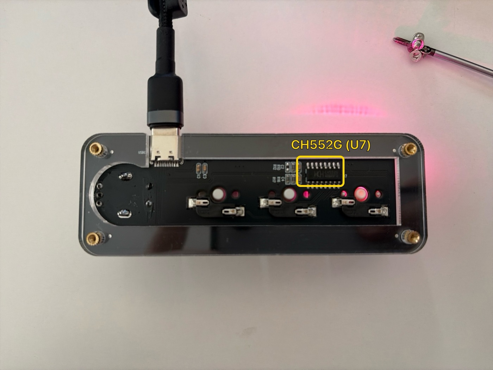
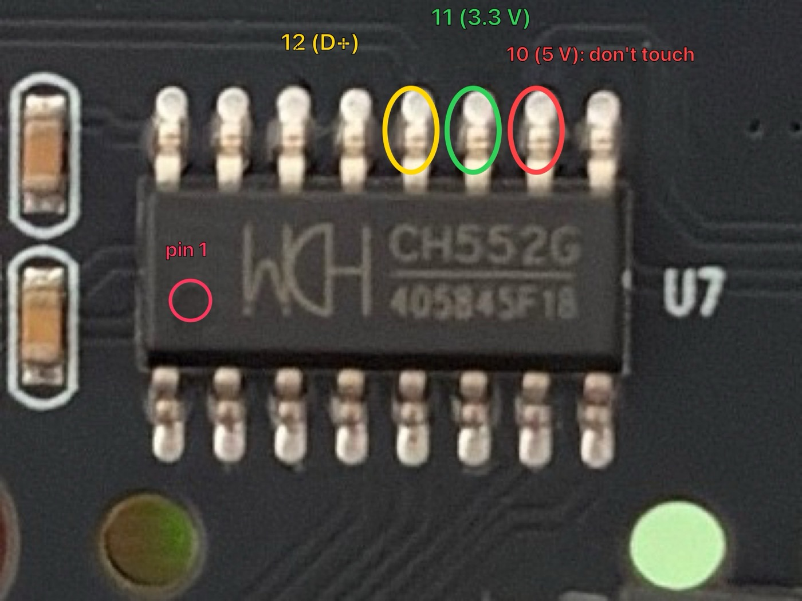
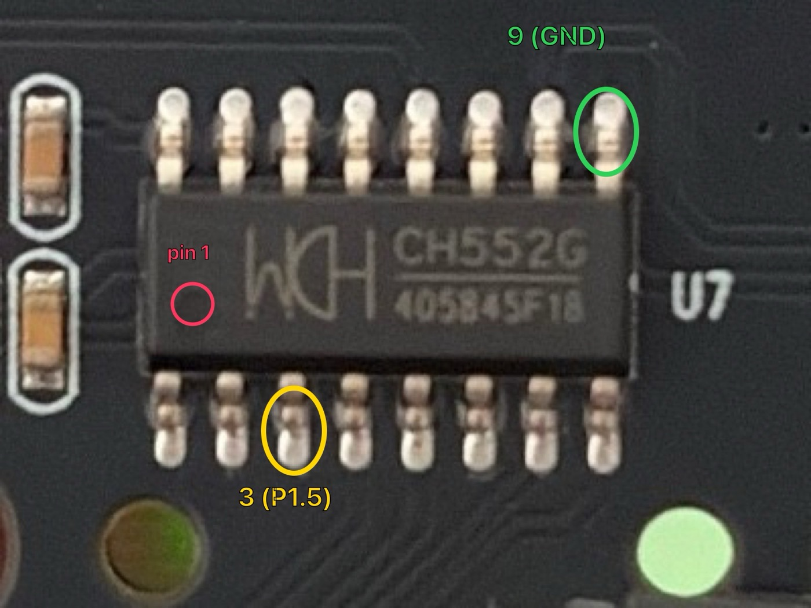

# MiniKeys Firmware

Custom firmware for the CH552G 3-key + knob USB keypad (USB `1189:8890`, sold as "MINI KeyBoard"),
and the tool that installs it. [MiniKeys](https://github.com/MeLlamoCarl/MiniKeys) works with both
the stock and this firmware, and shows its advanced light settings when this one is installed.

<p align="center"></p>

| | Stock firmware | MiniKeys firmware |
|---|---|---|
| Keys, combos, sequences, media, mouse, 3 layers | ✓ | ✓ |
| Light | off, on press, color wave (fixed colors) | off, on press, wave, solid, breathing, rainbow, layer color — any color, speed and brightness |
| Live key colors from the app | – | ✓ |
| Layer switch | rewrites the layer's keys | instant |
| Updates | – | over USB, without opening the keypad |

## Install

Requires macOS (Linux works too) with Python 3.9 or later.

```bash
git clone https://github.com/MeLlamoCarl/MiniKeys-Firmware.git
cd MiniKeys-Firmware
python3 -m venv .venv && .venv/bin/pip install -r flasher/requirements.txt
.venv/bin/python flasher/minikeys_flasher.py install
```

Quit MiniKeys first: both use the keypad's programming interface.

The tool detects what is connected:
- **MiniKeys firmware** → it restarts the keypad in bootloader mode over USB and updates it.
- **Stock firmware** → it walks you through the one-time step below and waits for the keypad.

Before writing, it saves the keypad's settings (its 128-byte data flash) to `backups/`.
**The stock firmware itself can't be read, so it can't be restored.**

### First install: bootloader mode by hand

1. Unplug the keypad and remove the bottom plate (4 screws). The chip is the CH552G marked U7.

   

2. With a **10 kΩ resistor** (or fine tweezers), connect **pin 12 (D+)** to **pin 11 (3.3 V)**.
   Pin 1 is next to the dimple on the chip. **Don't touch pin 10 (5 V)**: bridging it to pin 11
   can damage the chip.

   

3. Keep the contact and plug the keypad in; let go after a second. In bootloader mode the LEDs stay
   off. If they light up as usual, unplug and try again.

Chips with an older bootloader (before 2.4) use **pin 3 (P1.5)** to **pin 9 (GND)** instead:



Afterwards the keypad never needs opening again: updates go over USB, and holding **key 1** while
plugging it in also enters bootloader mode.

## Other commands

```bash
.venv/bin/python flasher/minikeys_flasher.py status        # what is connected
.venv/bin/python flasher/minikeys_flasher.py backup        # save the settings
.venv/bin/python flasher/minikeys_flasher.py flash FILE    # write another image
```

## Build the firmware

Requires SDCC (`brew install sdcc`).

```bash
make -C Firmware bin        # build Firmware/minikeys.bin
make -C Firmware release    # update the prebuilt image the flasher uses
make -C Firmware DIAG=1 bin # pin finder: each pin pulled low types its name
```

The commands the firmware understands are in [Firmware/README.md](Firmware/README.md).

## Credits and licenses

- Pin mapping and the idea: biemster's [RGB Macropad Custom Firmware](https://hackaday.io/project/189914).
- `Firmware/src` builds on Stefan Wagner's [CH55x libraries](https://github.com/wagiminator); the firmware
  is licensed under [CC BY-SA 3.0](https://creativecommons.org/licenses/by-sa/3.0/). `ch554.h` is WCH's
  register header.
- The flasher's bootloader protocol follows the documentation of [wchisp](https://github.com/ch32-rs/wchisp).

---

Built with the help of AI tools.
